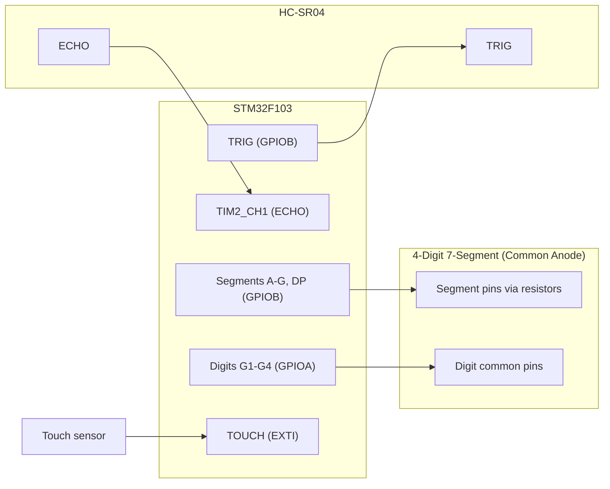
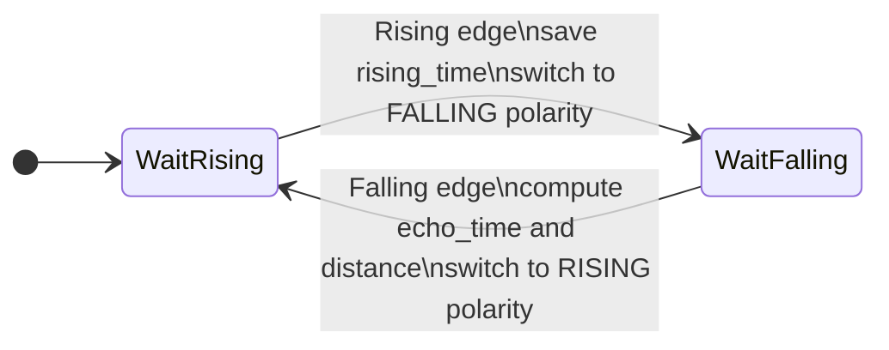
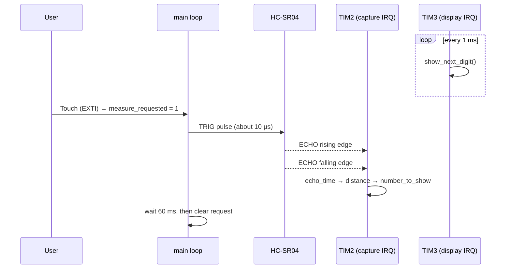

<!-- ======================= HEADER BANNER (animated) ======================= -->
<div align="center">


<a href="https://git.io/typing-svg">
  
</a>

<br/>


</div>

---

## 📸 Project Preview

<div align="center">

<!--
  👉 UPLOAD YOUR PROJECT PHOTO HERE
  1. Create the folder  docs/images/  in your repo
  2. Upload your photo as  docs/images/project.jpg   (or .png / .gif)
  3. Keep the file name the same, or change the path below.
  Tip: a short GIF showing the number changing while you move your hand
       in front of the sensor looks amazing here. 🎬
-->


<br/>

<sub><i>📷 The finished build: STM32 + HC-SR04 + 4-digit seven-segment display</i></sub>

</div>

---

## 📚 Table of Contents

- [✨ Overview](#-overview)
- [🎯 Features](#-features)
- [🧰 Hardware](#-hardware)
- [🔌 Pinout & Wiring](#-pinout--wiring)
- [🧠 How It Works](#-how-it-works)
  - [1. Measuring distance with ultrasound](#1-measuring-distance-with-ultrasound)
  - [2. Capturing the echo with Timer Input Capture](#2-capturing-the-echo-with-timer-input-capture)
  - [3. Driving the seven-segment display](#3-driving-the-seven-segment-display)
  - [4. Error handling](#4-error-handling)
- [⏱️ Timing & Clock Configuration](#️-timing--clock-configuration)
- [🗂️ Project Structure](#️-project-structure)
- [🚀 Build & Flash](#-build--flash)
- [🕹️ Usage](#️-usage)
- [🔧 Customization](#-customization)
- [🛣️ Roadmap](#️-roadmap)
- [👤 Author](#-author)
- [📄 License](#-license)

---

## ✨ Overview

This project is a **digital distance meter** built on an **STM32** microcontroller. It sends an ultrasonic pulse with an **HC-SR04** sensor, measures how long the echo takes to return using a hardware timer in **Input Capture** mode, converts that time into a distance, and shows the result in **centimeters with one decimal place** (for example `123.4`) on a **4-digit common-anode seven-segment display**.

Everything is written in **Embedded C** with the **STM32 HAL** library. Timing-critical work (echo measurement and display refresh) is handled by **hardware timers and interrupts**, so the main loop stays simple and the display never flickers while a measurement is running.

> 💡 **Why this project?** It is a compact way to practice the core skills of embedded systems: timers, input capture, interrupts, GPIO multiplexing, and sensor interfacing, all in one small device.

---

## 🎯 Features

| | Feature | Details |
|---|---|---|
| 📏 | **Wide range** | 2 cm to 400 cm (HC-SR04 working range) |
| 🔢 | **0.1 cm display resolution** | Shown as `XXX.X` with a decimal point on the third digit |
| ⏱️ | **1 µs timer resolution** | TIM2 runs at 1 MHz for precise echo timing |
| 🎯 | **Hardware Input Capture** | The timer records the echo edges itself, so there is no polling and no jitter from software |
| 💡 | **Flicker-free multiplexing** | TIM3 interrupt refreshes one digit every 1 ms |
| 👆 | **On-demand measurement** | A touch input (EXTI interrupt) triggers a new measurement, with 300 ms debounce |
| 🚨 | **Error indication** | The display shows `Err-` for out-of-range readings or a missing echo |
| 🧩 | **Clean separation** | Display refresh, capture, and triggering are independent and easy to modify |

---

## 🧰 Hardware

| Component | Quantity | Notes |
|---|:---:|---|
| STM32F103 board (Blue Pill or similar) | 1 | 72 MHz from an 8 MHz HSE crystal and PLL x9 |
| HC-SR04 ultrasonic sensor | 1 | Powered from 5 V |
| 4-digit **common-anode** seven-segment display | 1 | Segments and digit commons driven directly by GPIO |
| Current-limiting resistors | 8 | One per segment line, value depends on your display (typically 220 Ω to 1 kΩ) |
| Touch sensor / push button | 1 | Rising-edge external interrupt |
| ST-Link programmer | 1 | For flashing and debugging |
| Breadboard and jumper wires | - | |

> ⚠️ **Logic level note:** the HC-SR04 `ECHO` output is a 5 V signal. Use a voltage divider (for example 1 kΩ + 2 kΩ), or make sure the pin you use is 5 V tolerant, before connecting it to the STM32.

---

## 🔌 Pinout & Wiring

> ✏️ Fill the **Pin** column with the exact pins from your `main.h` / `.ioc` file so the table matches your build.

| Signal | STM32 port / peripheral | Pin | Description |
|---|---|:---:|---|
| `A` to `G`, `DP` | **GPIOB** (outputs) | `PB_` | Segment lines (active **LOW**) |
| `G1` to `G4` | **GPIOA** (outputs) | `PA_` | Digit select (common anode, active **HIGH**) |
| `TRIG` | **GPIOB** (output) | `PB_` | 10 µs trigger pulse to HC-SR04 |
| `ECHO` | **TIM2 CH1** (Input Capture) | `PA0` | Echo pulse from HC-SR04 |
| `TOUCH` | **EXTI line 10-15** (rising edge) | `P__` | Starts a new measurement |

### Wiring diagram



> 📐 You can also add a schematic image to `docs/images/schematic.png` and link it here.

---

## 🧠 How It Works

### 1. Measuring distance with ultrasound

The HC-SR04 sends a burst of 40 kHz ultrasound when it receives a **10 µs HIGH pulse** on `TRIG`. It then raises `ECHO` HIGH for as long as the sound takes to travel to the object **and back**.

```text
TRIG   ___┌──┐_____________________________________________
          10 µs

8 bursts of 40 kHz     ))) ))) ))) ))) ))) ))) ))) )))

ECHO   __________________┌────────────────────┐______________
                         │<──── t_echo ─────>│
                      rising edge          falling edge
```

**Derivation of the distance formula**

The sound travels to the object and back, so the total path is `2d`:

```text
2d = v · t
d  = (v · t) / 2
```

With the speed of sound at about 20 °C, `v ≈ 343 m/s = 0.0343 cm/µs`:

```text
d (cm) = (0.0343 cm/µs · t_echo) / 2
       = t_echo(µs) / 58.3
       ≈ t_echo(µs) / 58
```

Since the timer counts in **microseconds**, this is exactly what the code does:

```c
distance_cm = echo_time / 58.0f;
```

### 2. Capturing the echo with Timer Input Capture

**TIM2 (Channel 1)** is configured in Input Capture mode with a prescaler of 71, so the timer clock is `72 MHz / 72 = 1 MHz`, which gives **1 µs per tick**.

The capture interrupt uses a small two-state machine:



1. **Rising edge:** store the counter value in `rising_time`, then change the capture polarity to *falling*.
2. **Falling edge:** read `falling_time`, compute the pulse width, convert it to centimeters, then change the polarity back to *rising* for the next measurement.

The pulse width handles **16-bit counter overflow** correctly:

```c
if (falling_time >= rising_time)
    echo_time = falling_time - rising_time;
else
    echo_time = (0xFFFF - rising_time) + falling_time + 1;   // timer wrapped around
```

The timer period is 65 536 µs, which is longer than the longest valid echo (about 23.3 ms for 400 cm), so a single overflow is always handled correctly.

The result is converted to tenths of a centimeter and rounded, ready for the display:

```c
number_to_show = (uint16_t)(distance_cm * 10.0f + 0.5f);   // e.g. 123.4 cm -> 1234
```

### 3. Driving the seven-segment display

The display has **4 digits but only one set of 8 segment lines**, so the digits are shown one at a time, very quickly (**multiplexing**). The eye cannot see the switching, and all four digits appear to be lit at once.

```text
time ─────────────────────────────────────────────────────────►
G1  ███░░░░░░░░░░░░░░░░░███░░░░░░░░░░░░░░░░
G2  ░░░███░░░░░░░░░░░░░░░░░███░░░░░░░░░░░░░
G3  ░░░░░░███░░░░░░░░░░░░░░░░░███░░░░░░░░░░
G4  ░░░░░░░░░███░░░░░░░░░░░░░░░░░███░░░░░░░
    └─ 1 ms ─┘
    one full scan = 4 ms  →  250 Hz per digit (no visible flicker)
```

**TIM3** fires an interrupt every **1 ms**. Each interrupt calls `show_next_digit()`, which:

1. Turns **all digits off**.
2. Splits `number_to_show` into four decimal digits.
3. Puts the segment pattern of the current digit on the segment lines.
4. Turns **only the current digit on**.
5. Moves to the next digit.

**Common-anode logic**

| Line | To turn ON | Reason |
|---|---|---|
| Segment (A to G, DP) | **LOW (0)** | Current flows from the common anode, through the segment, into the pin |
| Digit common (G1 to G4) | **HIGH (1)** | The common anode must be connected to the supply |

Segment patterns are stored in a lookup table (`0` = segment on, `1` = segment off). Bit 0 is segment `A` and bit 6 is segment `G`:

```c
uint8_t digit_pattern[10] = {
    0b11000000, // 0
    0b11111001, // 1
    0b10100100, // 2
    0b10110000, // 3
    0b10011001, // 4
    0b10010010, // 5
    0b10000010, // 6
    0b11111000, // 7
    0b10000000, // 8
    0b10010000  // 9
};
```

The **decimal point** is switched on for the third digit, so a stored value of `1234` appears as `123.4`.

### 4. Error handling

The display shows **`Err-`** when:

| Condition | Reason |
|---|---|
| Distance `< 2 cm` or `> 400 cm` | Outside the sensor's reliable range |
| No falling edge within **50 ms** of the rising edge | The echo never ended, so the measurement is aborted and the capture state machine is reset |

The reset is done in the main loop, so the next measurement always starts from a clean state.

---

## ⏱️ Timing & Clock Configuration

| Item | Value |
|---|---|
| System clock | **72 MHz** (HSE 8 MHz x PLL 9) |
| APB1 / APB2 | 36 MHz / 72 MHz (timer clocks run at 72 MHz) |
| **TIM2** (echo capture) | Prescaler 71, period 65535 → **1 µs tick**, overflow every 65.5 ms |
| **TIM3** (display refresh) | Prescaler 71, period 999 → **1 ms interrupt** |
| Digit refresh rate | 1 ms x 4 digits = 4 ms per scan → **250 Hz** per digit |
| Measurement cycle | 60 ms wait after each trigger (recommended HC-SR04 cycle) |
| Touch debounce | 300 ms |

### Program flow



---

## 🗂️ Project Structure

```text
📦 stm32-ultrasonic-distance-meter
 ┣ 📂 Core
 ┃ ┣ 📂 Inc          # main.h, HAL config and interrupt headers
 ┃ ┗ 📂 Src          # main.c (application logic), HAL init and interrupt files
 ┣ 📂 Drivers        # STM32 HAL and CMSIS (generated by CubeMX)
 ┣ 📂 docs
 ┃ ┗ 📂 images       # project photo, schematic, demo GIF
 ┣ 📜 *.ioc          # STM32CubeMX configuration (pins, clocks, timers)
 ┣ 📜 .gitignore
 ┣ 📜 LICENSE
 ┗ 📜 README.md
```

### Key functions in `main.c`

| Function | Purpose |
|---|---|
| `trigger_ultrasonic()` | Generates the TRIG pulse for HC-SR04 |
| `HAL_TIM_IC_CaptureCallback()` | Handles rising/falling echo edges and computes the distance |
| `HAL_TIM_PeriodElapsedCallback()` | TIM3 tick, calls `show_next_digit()` |
| `show_next_digit()` | Multiplexing: selects one digit and shows its pattern |
| `set_segments()` | Writes a segment pattern and decimal point to GPIOB |
| `HAL_GPIO_EXTI_Callback()` | Touch input with debounce, requests a measurement |

---

## 🚀 Build & Flash

### Requirements

- 🖥️ **STM32CubeIDE** (or any toolchain that supports STM32CubeMX projects)
- 🔌 **ST-Link** programmer
- 📦 STM32 HAL drivers for the F1 series (included in the project)

### Steps

```bash
# 1. Clone the repository
git clone https://github.com/<your-username>/<repo-name>.git
cd <repo-name>
```

1. Open **STM32CubeIDE** and choose **File → Open Projects from File System**, then select the cloned folder.
2. (Optional) Open the `.ioc` file to inspect or change the pin, clock, and timer configuration.
3. Click **Build** 🔨 (`Ctrl + B`).
4. Connect the board through **ST-Link** and click **Run / Debug** ▶️ to flash it.

---

## 🕹️ Usage

1. ⚡ Power the board and the sensor.
2. 📏 Point the HC-SR04 at an object. A first measurement is taken automatically at start-up.
3. 👆 Touch the sensor input to take a new measurement.
4. 🔢 Read the distance in **cm** on the display (for example `123.4`).
5. 🚨 If the display shows `Err-`, the object is out of range or no echo was received. Adjust the distance and measure again.

---

## 🔧 Customization

| I want to... | Change this |
|---|---|
| Speed of sound for other temperatures | Replace `58.0f` with `2 / (v_cm_per_us)`, where `v ≈ 0.03314 + 0.0000606 · T(°C)` cm/µs |
| Faster or slower display refresh | Change the TIM3 `Period` (default 999 = 1 ms) |
| Continuous measurement | Set `measure_requested = 1` periodically instead of waiting for the touch input |
| Different range limits | Edit the `2.0f` / `400.0f` limits in the capture callback |
| Show millimeters or inches | Change the scaling used for `number_to_show` |

---

## 🛣️ Roadmap

- [ ] 🌡️ Temperature compensation with a sensor such as DS18B20 or LM35
- [ ] 📊 Moving-average or median filter to smooth readings
- [ ] 📟 UART output of distance values for logging
- [ ] 🔔 Buzzer or LED proximity alert
- [ ] 🧱 Custom PCB designed in Altium Designer

---

## 👤 Author

<div align="center">

**Mahyar**
Electrical Engineering Student at Shahid Beheshti University, Tehran 🇮🇷
Interests: digital electronics · embedded systems · communications

[](https://github.com/<your-username>)
[](https://www.linkedin.com/in/<your-profile>)
[](mailto:<your-email>)

⭐ If you found this project useful, consider giving it a star!

</div>

---

## 📄 License

This project is released under the **MIT License**. See the [LICENSE](LICENSE) file for details.
Files generated by STM32CubeMX (HAL, CMSIS) keep their original STMicroelectronics licenses.

<div align="center">


</div>
